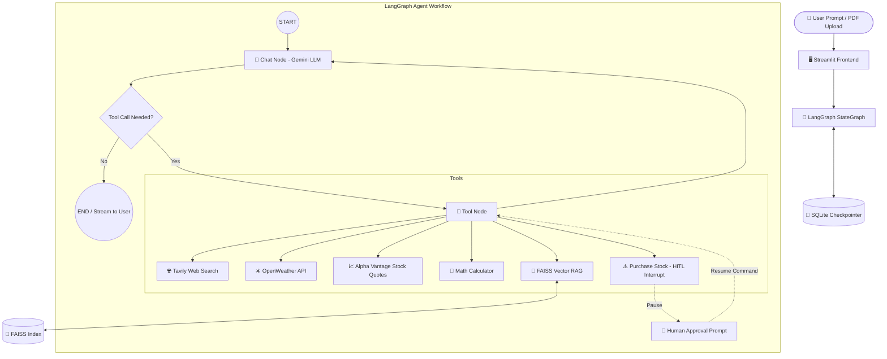

# 🤖 Agentic Chatbot with LangGraph & Streamlit

An advanced, production-grade conversational AI assistant powered by **LangGraph**, **Google Gemini**, and **Streamlit**. Built with tool orchestration, document RAG, persistent multi-thread SQLite checkpointing, and **Human-in-the-Loop (HITL)** approval workflows for sensitive actions.

🌐 **Live Demo:** [https://agentic-chatbot-langgraph.embarko.app](https://agentic-chatbot-langgraph.embarko.app)

---

## 🌟 Key Features

- **🧠 Multi-Tool Agentic Reasoning:** Uses LangGraph's `StateGraph` and conditional tool routing to dynamically decide when to answer directly or delegate to specialized external tools.
- **🛡️ Human-in-the-Loop (HITL) Safeguards:** Utilizes LangGraph's `interrupt()` primitive to pause execution before executing high-stakes operations (such as simulated stock purchases) and resumes via user approval in the Streamlit UI.
- **📚 Interactive PDF Document RAG:** Upload PDF files directly through the chat interface; documents are split and indexed in a local **FAISS** vector store for semantic retrieval using Google Generative AI embeddings.
- **⚡ Blazing Fast Streaming UI:** Real-time token streaming with live tool status badges (`st.status`), conversation branching, and rich Markdown rendering.
- **💾 Persistent SQLite Checkpointing:** Every conversation thread is recorded into an embedded SQLite checkpointer (`SqliteSaver`), enabling conversation persistence, history reloading, and session restoration across server restarts.
- **🌐 Built-in Tool Ecosystem:**
  - **Live Web Search:** Powered by Tavily Search API.
  - **Live Weather Updates:** Global real-time weather via OpenWeather API.
  - **Real-Time Stock Quotes:** Live stock quotes powered by Alpha Vantage.
  - **Stock Purchase (HITL):** Simulated trading protected by mandatory human authorization.
  - **Safe Math Calculator:** Evaluates mathematical expressions securely.
  - **Document Q&A (RAG):** Context-aware retrieval from uploaded PDF files.

---

## 🏗️ Architecture



---

## 🛠️ Tech Stack

- **Framework:** [LangGraph](https://github.com/langchain-ai/langgraph), [LangChain](https://github.com/langchain-ai/langchain)
- **LLM & Embeddings:** Google Gemini (`gemini-3-flash-preview`, `gemini-embedding-001`) via `langchain-google-genai`
- **Frontend:** [Streamlit](https://streamlit.io/)
- **Vector Database:** [FAISS](https://github.com/facebookresearch/faiss)
- **Checkpointing & Memory:** SQLite (`langgraph-checkpoint-sqlite`)
- **Search & External APIs:** Tavily Search, OpenWeather, Alpha Vantage

---

## 📁 Project Structure

```text
.
├── agentic_chatbot_hitl_backend.py  # LangGraph graph, tools, nodes & checkpointer
├── app_hitl.py                      # Streamlit web UI with HITL controls & file upload
├── requirements.txt                 # Project dependencies
├── .env.example                     # Environment variables template
├── .gitignore                       # Ignored files (secrets, database, cache)
└── README.md                        # Documentation
```

---

## 🚀 Getting Started

### 1. Prerequisites
- Python 3.10+ installed
- API Keys for:
  - [Google AI Studio](https://aistudio.google.com/) (Gemini API)
  - [Tavily AI](https://tavily.com/) (Web search)
  - [OpenWeather](https://openweathermap.org/api) (Weather forecasts)

### 2. Clone the Repository
```bash
git clone https://github.com/cartibhati/Agentic-Chatbot-with-Langgraph-.git
cd Agentic-Chatbot-with-Langgraph-
```

### 3. Create a Virtual Environment
```bash
# Windows
python -m venv .venv
.venv\Scripts\activate

# macOS / Linux
python3 -m venv .venv
source .venv/bin/activate
```

### 4. Install Dependencies
```bash
pip install -r requirements.txt
```

### 5. Configure Environment Variables
Copy `.env.example` to `.env` and fill in your API keys:
```bash
cp .env.example .env
```

Edit `.env`:
```ini
GEMINI_MODEL="gemini-3-flash-preview"
GEMINI_EMBEDDING_MODEL="gemini-embedding-001"
GOOGLE_API_KEY="your-google-api-key"

TAVILY_API_KEY="your-tavily-api-key"
OPENWEATHER_API_KEY="your-openweather-api-key"

# Optional: LangSmith Observability
LANGSMITH_TRACING="false"
```

---

## 💻 Running the Application

Launch the Streamlit web application:

```bash
streamlit run app_hitl.py
```

Once running, navigate to `http://localhost:8501` in your browser.

---

## 🧪 Testing Human-in-the-Loop (HITL)

To test the HITL approval flow:
1. Ask the chatbot:  
   `"Please purchase 10 shares of AAPL for me."`
2. The agent will call the `purchase_stock` tool and pause execution.
3. Two interactive buttons (**Approve Purchase** / **Reject Purchase**) will appear in the UI.
4. Clicking **Approve Purchase** sends a `Command(resume="yes")` back to LangGraph, which completes the simulated order and streams the confirmation.

---

## 📄 License

This project is licensed under the [MIT License](LICENSE).

